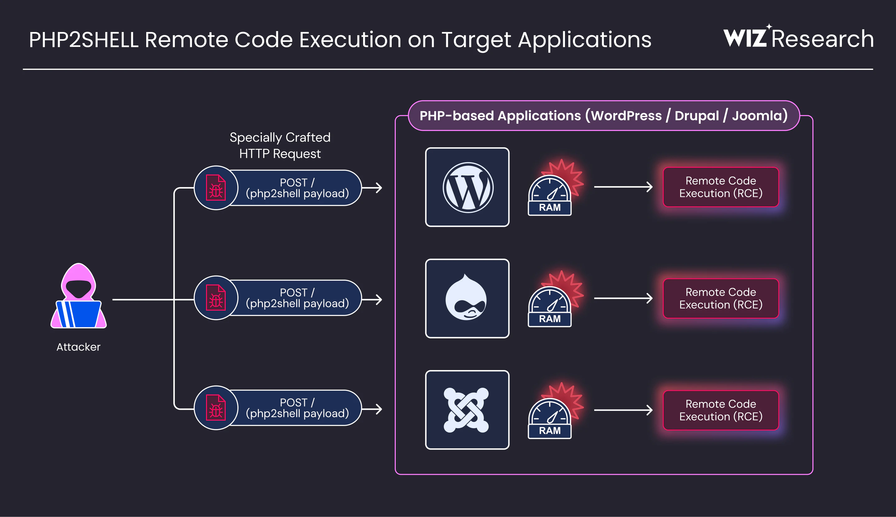
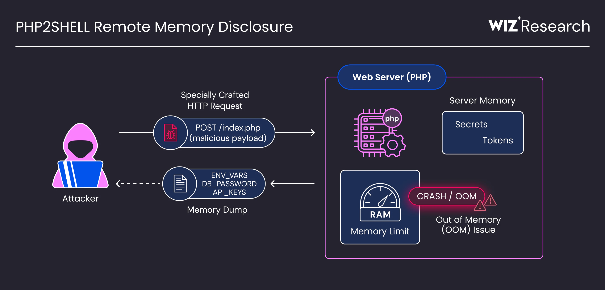

# PHP2Shell: CVE-2026-109618 & CVE-2026-109619 Defensive Audit Lab

An in-depth reproduction, defensive security auditing, and verification package for **CVE-2026-109618** (GHSA-w8hw-w9fx-j79w) and **CVE-2026-109619** (GHSA-6wmf-4rv5-p3rp) targeting the PHP C engine (PHP < 8.2.35 / 8.3.36 / 8.4.27 / 8.5.12).

---

## Table of Contents
1. [Executive Summary & Background](#1-executive-summary--background)
2. [Vulnerability Deep Dive: CVE-2026-109618](#2-vulnerability-deep-dive-cve-2026-109618)
   - [Architectural Scope: Pre-RINIT Multipart SAPI Parsing](#architectural-scope-pre-rinit-multipart-sapi-parsing)
   - [The Core Flaw: The Allocate-Then-Publish Invariant Violation](#the-core-flaw-the-allocate-then-publish-invariant-violation)
   - [Teardown Dereference of Stale HashTable Buckets](#teardown-dereference-of-stale-hashtable-buckets)
   - [Upstream Patch Analysis](#upstream-patch-analysis)
3. [Vulnerability Deep Dive: CVE-2026-109619](#3-vulnerability-deep-dive-cve-2026-109619)
   - [Architectural Scope: Persistent Web Workers](#architectural-scope-persistent-web-workers)
   - [The Core Flaw: Cross-Request Stale Global Session State](#the-core-flaw-cross-request-stale-global-session-state)
   - [Memory Lifecycle: Request-Scoped vs Process-Scoped Storage](#memory-lifecycle-request-scoped-vs-process-scoped-storage)
   - [Upstream Patch Analysis](#upstream-patch-analysis-1)
4. [Lab Architecture & Design](#4-lab-architecture--design)
   - [Web Application Layer](#web-application-layer)
   - [Runtime & Docker Configuration](#runtime--docker-configuration)
5. [Testing & Auditing Walkthrough](#5-testing--auditing-walkthrough)
   - [Automated Verification (`verify.py`)](#automated-verification-verifypy)
   - [Credential-Free Diagnostic Audits (`audit_check.py`)](#credential-free-diagnostic-audits-audit_checkpy)
   - [Manual Burp Suite Auditing Guide](#manual-burp-suite-auditing-guide)
   - [Playwright Visual Automation & Video Recording](#playwright-visual-automation--video-recording)
6. [Defense-in-Depth & Remediation](#6-defense-in-depth--remediation)

---

## 1. Executive Summary & Background

In October 2026, the PHP development team issued emergency releases across all supported branches (PHP 8.2.35, 8.3.36, 8.4.27, and 8.5.12) to address two critical memory corruption vulnerabilities rated CVSS 9.2:

* **CVE-2026-109618:** Memory corruption caused by out-of-memory (`OOM`) bailout conditions occurring during pre-request RFC 1867 multipart form parsing.
* **CVE-2026-109619:** Cross-request Use-After-Free (`UAF`) resulting from persistent web worker processes retaining global session pointers across request boundaries.

This repository provides two self-contained, containerized target environments, diagnostic audit tooling, and an end-to-end browser automation suite to analyze these mechanisms defensively.

<p align="center">
  
</p>

```text
┌─────────────────────────────────────────────────────────────────────────────┐
│                          HTTP CLIENT REQUEST                                │
└─────────────────────────────────────┬───────────────────────────────────────┘
                                      │
                                      ▼
             [ Web Server SAPI Layer: Apache MPM Prefork / PHP-FPM ]
                                      │
                ┌─────────────────────┴─────────────────────┐
                │                                           │
                ▼                                           ▼
      [ Pre-RINIT SAPI Parsing ]                 [ Persistent Worker Globals ]
      CVE-2026-109618:                           CVE-2026-109619:
      - RFC 1867 Multipart Stream                - Worker Process Survives (PID)
      - Bucket Counters Published Early          - Global PS(id) Retained
      - OOM Bailout (longjmp)                    - Freed Memory Re-accessed
      - Shutdown Destructor Dereference          - Cross-Request UAF
                │                                           │
                └─────────────────────┬─────────────────────┘
                                      │
                                      ▼
               [ Application Scripts: login.php / admin.php ]
             (Only reached if pre-request initialization succeeds)
```

---

## 2. Vulnerability Deep Dive: CVE-2026-109618

### Architectural Scope: Pre-RINIT Multipart SAPI Parsing
When an HTTP client submits a request with `Content-Type: multipart/form-data`, PHP processes the raw body before userland scripts execute. This occurs inside the Server API (SAPI) request startup phase (`pre-RINIT` in `main.c` / `ext/standard/rfc1867.c`).

During this phase, PHP parses boundaries, headers, and form parameters to populate the global arrays `$_POST` and `$_FILES`.

### The Core Flaw: The Allocate-Then-Publish Invariant Violation
In standard memory safety principles, a data structure must only update its size or publish item availability **after** memory allocation succeeds.

In unpatched versions of the Zend Engine (`Zend/zend_hash.c`), bucket allocation routines incremented table usage counters before verifying memory availability:

```c
/* Pseudocode representation of the unpatched HashTable insertion */
static zend_always_inline Bucket *zend_hash_add_or_update_i(HashTable *ht, zend_string *key) {
    uint32_t idx = ht->nNumUsed++;  /* BUG: Counter published before allocation! */
    ht->nNumOfElements++;

    Bucket *p = ht->arData + idx;
    p->val = emalloc(sizeof(zval)); /* If this OOMs, execution aborts immediately! */
    ...
}
```

### Teardown Dereference of Stale HashTable Buckets
1. **OOM Bailout:** If an allocation trips PHP's `memory_limit` (configured to `16M` in this lab), the Zend memory manager does not return an error code; it performs a hard `zend_bailout()` using `setjmp`/`longjmp`.
2. **Shutdown Invocation:** `zend_bailout()` halts execution and transfers control to `php_request_shutdown()`.
3. **Ghost Bucket Traversal:** During shutdown, the engine cleans up HashTables by walking from index `0` up to `ht->nNumUsed`.
4. **Stale Memory Read:** Because `ht->nNumUsed` was incremented before the bucket memory was allocated, the engine attempts to clean up uninitialized memory. It treats arbitrary heap bytes as a valid `zval`, attempting to invoke its destructor pointer (`pDestructor`), leading to crashes (`SIGSEGV`) or control flow manipulation in groomed environments.

### Upstream Patch Analysis
The upstream fix across PHP 8.2.35, 8.3.36, 8.4.27, and 8.5.12 introduced an engine-wide fallible allocation refactor:
* **Allocate-Before-Publish:** `_zend_hash_add_or_update_i` and table resizing routines now allocate memory first and return `HASH_NOMEM` before updating `nNumUsed`.
* **Fallible Allocations (`femalloc`):** Memory allocations return `NULL` upon failure instead of jumping immediately to a bailout.
* **Teardown Guards (`ZEND_HAS_OOM()`):** Request teardown functions check if the request was aborted due to OOM and abort cleanup before touching unfinalized structures.

---

## 3. Vulnerability Deep Dive: CVE-2026-109619

### Architectural Scope: Persistent Web Workers
In high-performance web deployments (such as Apache MPM Prefork or PHP-FPM), worker processes are persistent. Instead of terminating when a request finishes, a worker process stays alive to handle hundreds or thousands of consecutive HTTP requests (`MaxConnectionsPerChild > 0` or `0`).

### The Core Flaw: Cross-Request Stale Global Session State
PHP operates with two memory tiers:
1. **Request-Scoped Memory (`emalloc` / `efree`):** Allocated per request and cleared at request shutdown.
2. **Process-Scoped Memory & Globals (`malloc` / Engine Globals):** Persists across the lifetime of the worker process.

In unpatched PHP, if a request triggered early session handling (such as `session.upload_progress` tracking or cookie generation) and subsequently encountered an OOM bailout:
* Request-scoped memory holding session string data was wiped by `php_request_shutdown()`.
* **The Global Pointer Gap:** Global session pointers (`PS(id)`, `PS(send_cookie)`, or `BG(serialize)`) were **not reset to `NULL`**.

```text
[ Request A ] (OOMs during session processing)
     │
     ├── 1. Allocates session ID string in request memory.
     ├── 2. Global worker pointer PS(id) points to request string.
     ├── 3. OOM bailout occurs.
     ├── 4. Request memory is wiped by engine shutdown.
     └── 5. FLAW: PS(id) pointer is NOT reset to NULL!
     
[ Request B ] (Arrives at the exact same worker process)
     │
     ├── 1. SAPI begins processing Request B.
     ├── 2. Engine accesses global pointer PS(id) before re-initialization.
     └── 3. USE-AFTER-FREE: PS(id) points to dead/reallocated memory.
```

<p align="center">
  
</p>

### Upstream Patch Analysis
In the patched releases (8.4.27+ and 8.5.12+):
* **Strict Global Nullification:** Session globals (`PS(id)`, `PS(send_cookie)`, `PS(http_session_vars)`) are explicitly cleared upon any bailout or abort.
* **Pre-RINIT Session Lock:** A new `PS(in_rfc1867_update)` flag forces `incomplete_classes_only` during early multipart processing, blocking userland code and classes from interacting with session state prior to module initialization.

---

## 4. Lab Architecture & Design

### Web Application Layer
Both environments provide a modern, responsive web application built with vanilla PHP, CSS glassmorphism, and dark mode aesthetics:
* **`index.php`:** Laboratory portal displaying runtime configuration, target CVE parameters, and operational metrics.
* **`login.php`:** Authentication endpoint utilizing `session_regenerate_id(true)` to defend against session fixation attacks.
* **`admin.php`:** Access-restricted administrative security dashboard displaying live Zend engine telemetry (`memory_get_usage`), Apache Worker PID (`getmypid()`), runtime limits, and defensive allocation probes.
* **`logout.php`:** Full session invalidation and cookie expiration.
* **`config.php`:** Central security configuration and access enforcement (`requireAuth()`).

### Runtime & Docker Configuration
Each environment runs in an isolated Docker container configured to reproduce specific research conditions:

| Parameter | CVE-2026-109618 Lab | CVE-2026-109619 Lab |
|---|---|---|
| **Base Image** | `php:8.4.26-apache` (Unpatched) | `php:8.4.26-apache` (Unpatched) |
| **Container Port** | `8081` | `8082` |
| **MPM Architecture** | Dedicated Single-Worker Prefork | Persistent Multi-Request Prefork |
| **Memory Limit** | `memory_limit = 16M` | `memory_limit = 128M` |
| **Post Max Size** | `post_max_size = 32M` | `post_max_size = 32M` |
| **Upload Progress** | Default | `session.upload_progress.enabled = 1` |

---

## 5. Testing & Auditing Walkthrough

### Default Credentials
* **Username:** `admin`
* **Password:** `CyberLab2026!`

---

### Automated Verification (`verify.py`)
Validates application-layer security, authentication flows, session handling, and access restrictions:

```powershell
# Verify CVE-2026-109618
python e:\cyber\demo\CVE-2026-109618\verify.py http://localhost:8081

# Verify CVE-2026-109619
python e:\cyber\demo\CVE-2026-109619\verify.py http://localhost:8082
```

---

### Credential-Free Diagnostic Audits (`audit_check.py`)
Audits server boundaries, access guards, SAPI multipart parsing, and worker lifecycle without providing user credentials:

```powershell
# Audit CVE-2026-109618 (Multipart SAPI & Health)
python e:\cyber\demo\CVE-2026-109618\audit_check.py http://localhost:8081

# Audit CVE-2026-109619 (Worker PID Continuity & Upload Progress)
python e:\cyber\demo\CVE-2026-109619\audit_check.py http://localhost:8082
```

---

### Manual Burp Suite Auditing Guide

Using Burp Suite Repeater, security auditors can inspect engine behavior at the HTTP protocol boundary:

#### Test 1: SAPI RFC 1867 Parsing (Port 8081)
Send a basic multipart POST to `/login.php`:
```http
POST /login.php HTTP/1.1
Host: localhost:8081
Content-Type: multipart/form-data; boundary=----AuditBoundary123
Content-Length: 175

------AuditBoundary123
Content-Disposition: form-data; name="test_field"

diagnostic_probe
------AuditBoundary123--
```
* **Observation:** The PHP engine accepts and parses the multipart boundaries into memory before evaluating credentials.

#### Test 2: Inspecting Memory Limit Responses (Port 8081)
Because `memory_limit = 16M` while `post_max_size = 32M`, submitting data exceeding 16MB triggers an engine-level abort:
* **Response with `display_errors = 1`:**
  ```text
  Fatal error: Allowed memory size of 16777216 bytes exhausted in Unknown on line 0
  ```
  *(Note that `Unknown on line 0` indicates the failure occurred in SAPI code before script execution).*

#### Test 3: Tracking Persistent Worker PID Continuity (Port 8082)
Send repeated `GET /login.php` requests to port 8082:
```http
GET /login.php HTTP/1.1
Host: localhost:8082
Connection: keep-alive
```
* **Observation:** Inspect the HTML body for `Worker PID: <code>...</code>`. The PID remains constant across consecutive requests, proving single-worker process persistence.

---

### Playwright Visual Automation & Video Recording

The repository includes a Playwright browser automation script (`record_walkthrough.py`) that steps through the application, logs security explanations, and **records an end-to-end video**.

#### Interactive Live Playback (Visible Browser with 1s Delays):
```powershell
cd e:\cyber\demo
python record_walkthrough.py http://localhost:8081
```

#### Headless Background Recording:
```powershell
python record_walkthrough.py http://localhost:8081 --headless
```

#### Video Output:
All recordings are saved in WebM format to:
📁 **`e:\cyber\demo\videos\*.webm`**

---

## 6. Defense-in-Depth & Remediation

To secure systems against this vulnerability class, implement the following defensive controls:

1. **Immediate Runtime Upgrade:**
   Update PHP immediately to patched releases:
   * **PHP 8.2:** Upgrade to **8.2.35+**
   * **PHP 8.3:** Upgrade to **8.3.36+**
   * **PHP 8.4:** Upgrade to **8.4.27+**
   * **PHP 8.5:** Upgrade to **8.5.12+**

2. **Harmonize Memory and SAPI Limits:**
   Configure `post_max_size` to be strictly less than or equal to `memory_limit` in `php.ini`:
   ```ini
   memory_limit = 128M
   post_max_size = 16M
   upload_max_filesize = 16M
   ```
   *This ensures oversized payloads are rejected early by the web server rather than causing in-engine OOM bailouts.*

3. **Session & Cookie Hardening:**
   ```ini
   session.use_only_cookies = 1
   session.cookie_httponly = 1
   session.cookie_secure = 1
   session.cookie_samesite = "Lax"
   ```
   *Always call `session_regenerate_id(true)` upon privilege elevation to mitigate session fixation.*

4. **Disable Unused Engine Features:**
   If real-time file upload progress bars are not required, disable upload progress tracking:
   ```ini
   session.upload_progress.enabled = 0
   ```

5. **Worker Recycling:**
   In Apache MPM Prefork, set `MaxConnectionsPerChild` (e.g., `1000`) or in PHP-FPM set `pm.max_requests` to periodically recycle persistent worker processes, clearing accumulated heap state.

---

## 7. Deep-Dive References & Technical Playbooks

For advanced technical details, incident response guides, and WAF rules:
* 📘 **[docs/ARCHITECTURE_DEEP_DIVE.md](./docs/ARCHITECTURE_DEEP_DIVE.md):** Zend Memory Manager internals, small/large bins, bailout longjmp mechanics, and C-level code analysis.
* 🛡️ **[docs/WAF_AND_HARDENING_GUIDE.md](./docs/WAF_AND_HARDENING_GUIDE.md):** ModSecurity / OWASP Core Rule Set (CRS) filtering rules, Nginx/Apache reverse proxy configurations, and runtime hardening.
* 🔍 **[docs/INCIDENT_RESPONSE_GUIDE.md](./docs/INCIDENT_RESPONSE_GUIDE.md):** Log forensics, grep signatures for pre-RINIT crashes (`Unknown on line 0`), and GDB core dump stack analysis.

